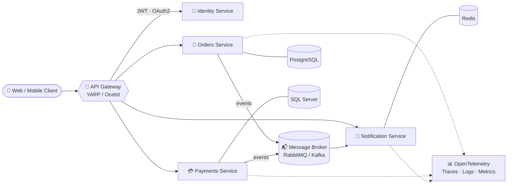

<!-- ═══════════════════════════════  HEADER  ═══════════════════════════════ -->
<p align="center">
  
</p>

<p align="center">
  <a href="https://git.io/typing-svg">
    
  </a>
</p>

<p align="center">
  <a href="https://prateekpandey8318.vercel.app/"></a>
  <a href="https://www.linkedin.com/in/prateek-pandey-6087b624b/"></a>
  <a href="mailto:prateekpandey2580@gmail.com"></a>
  
</p>

<p align="center">
  
  
  
</p>

---

## 👨‍💻 About Me


I'm a **Full-Stack Engineer** with a **backend-first mindset** and a **product-oriented approach**.
I design **.NET microservices**, build **API-first platforms**, and ship **end-to-end web & mobile products** with the **MERN stack** and **React Native** — systems built to survive real traffic, real teams and real growth.

> *"Great systems are invisible when they work — and unforgettable when they fail. My job is to make sure they don't fail."*

- 🏗️ &nbsp;Architecting **multi-tenant SaaS backends** with Clean Architecture & DDD
- ⚡ &nbsp;Building **high-performance REST / gRPC APIs** behind API gateways
- 📊 &nbsp;Crafting **admin dashboards & analytics** that teams actually enjoy using
- 📱 &nbsp;Shipping **cross-platform mobile apps** with React Native
- 🤝 &nbsp;Turning **business requirements into production-ready software** — on time

<br clear="right"/>

```csharp
public sealed class Prateek : Engineer
{
    public string   Role      => "Full-Stack Engineer · .NET Microservices Architect";
    public string[] Backend   => [".NET 8", "ASP.NET Core", "Node.js", "Express", "gRPC"];
    public string[] Frontend  => ["React", "Next.js", "TypeScript", "Tailwind CSS"];
    public string[] Mobile    => ["React Native", "Kotlin"];
    public string[] Patterns  => ["Clean Architecture", "DDD", "CQRS", "Event-Driven", "Sagas"];
    public string[] Values    => ["Clarity > Cleverness", "Maintainability", "Observability", "DX"];
    public string   Motto     => "Design for change. Build for scale. Ship with confidence.";

    public bool IsAvailableForWork() => true; // 🚀 let's talk
}
```

---

## 🛠️ Tech Arsenal

<h4 align="center">⚙️ Languages & Frameworks</h4>
<p align="center">
  
</p>

<h4 align="center">🗄️ Databases & Messaging</h4>
<p align="center">
  
</p>

<h4 align="center">☁️ DevOps, Cloud & Tooling</h4>
<p align="center">
  
</p>

<br/>

<div align="center">

| Domain | What I work with |
|:--|:--|
| 🏛️ **Architecture** | Clean Architecture · DDD · CQRS · Event-Driven · Microservices · Modular Monoliths |
| 🌐 **APIs** | REST · gRPC · API Gateway (Ocelot / YARP) · Versioned contracts · OpenAPI / Swagger |
| 🔐 **Security** | OAuth2 · OpenID Connect · JWT · RBAC · Service-to-service auth · Rate limiting |
| ⚡ **Resilience** | Polly · Retries · Timeouts · Circuit breakers · Sagas · Outbox · Eventual consistency |
| 📊 **Observability** | OpenTelemetry · Distributed tracing · Serilog structured logs · Metrics & health checks |
| 🗃️ **Data** | EF Core · Dapper · Mongoose · Query optimization · Indexing · Caching with Redis |
| 🚀 **Delivery** | Docker · GitHub Actions · CI/CD pipelines · Cloud deployment · Zero-downtime releases |

</div>

---

## 🏗️ How I Build Microservices



<table>
<tr>
<td width="50%" valign="top">

**Every service I design is:**

- ✅ Contract-driven & versioned
- ✅ Secure by default
- ✅ Observable in production
- ✅ Resilient to failure
- ✅ Cloud-ready from day one

</td>
<td width="50%" valign="top">

**Hands-on with:**

- 🚪 API gateways & smart routing
- 🔑 Service-to-service authentication
- 🗃️ Polyglot persistence
- 🔄 Sagas & distributed transactions
- 📬 Background workers & message pipelines

</td>
</tr>
</table>

---

## 📌 Featured Projects

<table>
<tr>
<td width="50%" valign="top">

### 🏨 Hotel Management System
Full-featured hotel operations platform — rooms, bookings, guests and billing, with a clean, responsive admin UI.


[🔗 Live Demo](https://hotel-management-six-henna.vercel.app) · [💻 Code](https://github.com/prateek8318/Hotel-management)

</td>
<td width="50%" valign="top">

### 🏫 RB School — Admin + Backend
School management platform with a dedicated TypeScript API and admin dashboard for students, staff and academics.


[🔗 Live Demo](https://rbschool-admin.vercel.app) · [💻 Admin](https://github.com/prateek8318/rbschool-admin) · [⚙️ Backend](https://github.com/prateek8318/rbschool-backend)

</td>
</tr>
<tr>
<td width="50%" valign="top">

### 📈 RankUp Admin
Admin console for managing users, content and performance analytics — built for clarity and speed.


[💻 Code](https://github.com/prateek8318/rankup-admin)

</td>
<td width="50%" valign="top">

### 🏙️ 3D Mohalla
Interactive 3D city experience on the web — immersive, explorable and fun.


[🔗 Live Demo](https://apun-ka-city.vercel.app) · [💻 Code](https://github.com/prateek8318/3D-Mohalla)

</td>
</tr>
<tr>
<td width="50%" valign="top">

### 📍 Device Tracker
Real-time device tracking app with location monitoring and status updates.


[💻 Code](https://github.com/prateek8318/device_tracker)

</td>
<td width="50%" valign="top">

### 🅿️ Parking Mitra
Smart parking management — slot booking, entries/exits and billing in one place.


[💻 Code](https://github.com/prateek8318/Parking-Mitra)

</td>
</tr>
<tr>
<td width="50%" valign="top">

### 🎮 Shadow Protocol
Android game built natively in Kotlin.


[💻 Code](https://github.com/prateek8318/Shadow-Protocol)

</td>
<td width="50%" valign="top">

### 🚀 Space Defender
Fast-paced arcade shooter built with TypeScript.


[💻 Code](https://github.com/prateek8318/SpaceDefender)

</td>
</tr>
</table>

<p align="center">
  <a href="https://github.com/prateek8318?tab=repositories"></a>
  <a href="https://prateekpandey8318.vercel.app/"></a>
</p>

---

## 💼 What I Can Build For You

<div align="center">

| 🧩 Service | 📦 What you get |
|:--|:--|
| **SaaS Backends** | Multi-tenant .NET / Node.js APIs with auth, billing hooks and role-based access |
| **Admin Dashboards** | Fast React / Next.js panels with analytics, charts, tables and exports |
| **Microservices Migration** | Breaking monoliths into clean, independently deployable services |
| **Mobile Apps** | Cross-platform React Native apps connected to robust APIs |
| **API Integrations** | Payment gateways, third-party APIs, webhooks and automation pipelines |
| **Performance & Scaling** | Query tuning, caching, background jobs and cloud deployment |

</div>

---

## 🧠 Engineering Principles

<div align="center">

| | Principle |
|:-:|:--|
| 🧩 | Think in **systems**, not just features |
| 🔁 | Design for **change**, not just for today |
| 🔍 | Optimize for **clarity**, not cleverness |
| 📈 | Build for **scale**, not just success |
| 🧪 | Ship with **tests & observability**, not hope |

</div>

---

## 🎯 Current Focus

- 🔭 Building **SaaS-grade .NET microservices** and API-first backend platforms
- 📡 Deepening work in **distributed tracing & observability** (OpenTelemetry)
- ⚙️ **High-performance database design** and query optimization
- 📱 Shipping production **React Native** apps
- 📚 Teaching **clean architecture** through real, working systems

---

## 📊 GitHub Analytics

<p align="center">
  
  
</p>

<p align="center">
  
</p>

<p align="center">
  
</p>

---

## 🤝 Let's Build Something Great

<p align="center">
  I enjoy working with people who care about <b>quality</b>, <b>architecture</b> and <b>impact</b>.<br/>
  Open to <b>full-time roles</b>, <b>freelance projects</b>, <b>consulting</b> and <b>technical collaborations</b>.<br/><br/>
  <i>Have an idea, a product or a messy codebase? Let's talk — I reply within 24 hours.</i>
</p>

<p align="center">
  <a href="mailto:prateekpandey2580@gmail.com"></a>
  <a href="https://www.linkedin.com/in/prateek-pandey-6087b624b/"></a>
  <a href="https://prateekpandey8318.vercel.app/"></a>
</p>

<p align="center">
  <b>⭐ Design for change. Build for scale. Ship with confidence. ⭐</b>
</p>

<p align="center">
  
</p>
